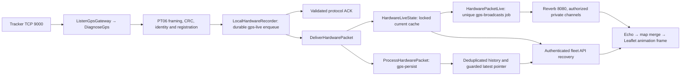

# GPS realtime audit — 28 October 2026

## Outcome and scope

Audited the existing receiver, parsers, registry/authentication, history/latest
storage, queues, Reverb, private channels, map subscriptions and Windows runtime
before changing the pipeline. Fixed reproducible server defects and added
correlated diagnostics. This is a local implementation and measured validation,
not proof of parity with Militrack or a completed cellular field trial.
No existing GPS records, device configurations, credentials, permissions or
application schema were deleted or changed by this audit. The earlier dashboard
ownership migration is separate from this audit.

## Actual dependency map

The running port 9000 entry is `gps:listen --diagnostic --persist --registered
--diagnostic-protocol=pt06`, delegated by `ListenGpsGateway::handle` to
`DiagnoseGps`. It uses active SQL registrations, a fixed PT06-compatible decoder,
database queues and file cache. It is not the Redis-only gateway path.



`SuperviseGpsWorkers` manages only the dedicated GPS queues. One warm worker per
queue is retained; backlog/age add bounded burst workers. The separate mobile
TG1/TLS flow and other application events remain separate. Reverb is shared
with other features; it was preserved during the GPS reload. No second tracking
pipeline was introduced.

The alternate `Gateway::feed` path requires Redis queue/cache and an allowlist.
Its routing was audited and corrected, but it is not active locally. Horizon's
default Redis configuration does not supervise these local database GPS queues.
PHP here is 8.4.27 without PCNTL or native Redis; Predis is available. Inventory
found one actual GPS listener and one Reverb listener, not competing receivers.

## Confirmed issues and fixes

| Evidence / responsible code | Change and practical effect |
| --- | --- |
| `GpsDevice::getIsOnlineAttribute`, `HardwareFleet`, `HardwareLiveState::classify` and frontend status treated closed TCP as offline despite recent authenticated traffic. | Availability now uses configurable last packet age, default 180 seconds. TCP presence, heartbeat, GPS fix age and movement remain distinct. A stale fix is not relabelled fresh. |
| Listener socket idle policy was coupled to availability timeout. | `GPS_SOCKET_IDLE_SECONDS=0` keeps authenticated idle sockets open; unauthenticated login still has a deadline. Receiver lease refresh does not extend last-packet freshness. |
| Repeated valid login on an already authenticated binary connection reached the authenticated packet decoder and could be rejected. | Same-IMEI login retries are validated and ACKed; changing identity on the same connection is rejected. Tests cover both. |
| Both read loops could deliver more than 64 valid small frames into a parser call with a 64-frame guard. | Read turns are bounded to 128 bytes; fragmented and coalesced packets still assemble correctly. Byte/buffer/authentication limits remain. The unrelated read-count limiter was removed from the strict gateway. |
| Diagnostic ACK writes followed the batch's formatting/processing. | ACK flush now follows validation and durable enqueue, before diagnostic formatting, with partial nonblocking writes retained. TCP_NODELAY is enabled. |
| Dormant Redis live-first enqueue targeted the legacy queue while the dedicated pool services gps-live/gps-persist/gps-broadcasts. | Input routes to gps-live; session/diagnostic storage routes to gps-persist. Startup rejects a mismatched live connection before binding. Routing tests require no Redis service. |
| Slow broadcast publication could occupy live projection. | Per-device unique events run on gps-broadcasts and resolve newest authorized cached state at dispatch. History runs independently on gps-persist. Broadcast coalescing never removes history input. |
| A WebSocket gap could leave a page waiting for a later fix. | Subscription/reconnect triggers authoritative snapshot recovery; bounded two-second reconciliation remains. Late HTTP responses cannot rewind newer live state. |
| Existing process reports did not correlate receipt, ACK, queue, publication and render. | Added metadata phase traces, gps:health, pool status and bounded local browser measurements. No raw packet bodies or credentials in new traces. |
| Pool monitoring could terminate the supervisor when queue storage became unavailable. | Retain bounded workers, expose unavailable status and retry monitoring. Worker shutdown now supports --stop between jobs. |

`HardwareConnectionState` tracks session identities, so an old disconnect cannot
remove a newer connection. `keepAlive` renews socket presence only. Login and
heartbeat without coordinates retain the last valid fix. History uses packet
deduplication and guarded latest updates; old jobs cannot rewind GPS state.
Tests also check that warm projections do not read history tables. Existing IMEI,
dedupe, device/time history and latest-pointer indexes were retained; no measured
query bottleneck justified a speculative migration.

The registry describes the reported tracker as PT06-compatible with exact model
unconfirmed. Verified fixtures cover login, heartbeat, location, alarm, CRC,
length, fragmentation and serial-matched ACKs. The existing optional PT06 0x22
ACK setting was preserved; manufacturer/firmware confirmation is still needed.
General GT06 compatibility does not prove every variant uses identical ACK rules.
Primary comparison: [Traccar GT06 decoder](https://raw.githubusercontent.com/traccar/traccar/master/src/main/java/org/traccar/protocol/Gt06ProtocolDecoder.java).

## Measured end-to-end test

Accepted run: `tmp/gps-audit-1793181923157/results.json`; screenshot:
`tmp/gps-audit-1793181923157/dashboard.png`. A copy of the numeric result is
[gps-audit-results-2026-10-28.json](gps-audit-results-2026-10-28.json).

Real TCP sockets, isolated MySQL/MariaDB, database queues, separate Reverb and
authenticated headless Chrome ran on the same host. Three synthetic devices
sent one GPS fix per second, then one sent 180 heartbeats as a coalesced burst
while the others continued GPS. Fragmented login, repeated login, real browser
subscription, broker outage/restart, latest-API recovery, history counts and
drawer interactions were exercised. Ports: HTTP 18091, TCP 19005, Reverb 18089,
Vite 15179. The tool created and removed only its own guarded random database.

| Duration, milliseconds | Samples | p50 | p95 | Maximum |
| --- | ---: | ---: | ---: | ---: |
| Sender write to ACK receipt, including burst waiting | 237 | 872.75 | 3021.58 | 3213.78 |
| Receiver complete-frame read to ACK write | 237 | 46.14 | 202.15 | 373.35 |
| Durable input to projection queue delay | 237 | 976 | 1447 | 1631 |
| Latest GPS frame receipt to browser event | 47 | 161 | 319 | 396 |
| Latest GPS frame receipt to first marker animation frame | 47 | 172 | 326 | 401 |
| Browser event to first marker frame, monotonic | 47 | 5.60 | 12.40 | 12.80 |

All 237 expected frames arrived. All 51 GPS locations were stored: **zero history
loss, zero unexpected TCP disconnects, zero failed jobs, zero jobs after drain**.
Peak sampled pending jobs: 65; peak workers: five (three warm plus two burst).
The isolated broker restart recovered a fix through the API without another GPS
packet in **1727 ms**. It then reconnected successfully. There were 47 rendered
trace samples because broadcasts intentionally coalesce and one fix was recovered
without a WebSocket event; this count is not evidence of history packet loss.

The 3.2-second burst ACK maximum is a remaining capacity limit of this local
durable database ingress, not hidden as a subsecond guarantee. Read-to-ACK begins
when the read completing a frame occurs; it excludes time waiting earlier in TCP
buffers. It includes validation, authorization and durable enqueue. Marker
measurements describe first rendered movement, not completion of interpolation.
Cross-process durations require synchronized clocks. Device fix time and receive
time are measured separately; simulated results do not include a cellular link.

The map filled the available content viewport (834.625 of 950 pixels after the
application header). All drawers were closed by default; vehicle and information
icons opened their drawers. Dashboard browser errors: zero. The isolated login
page reported `THREE is not defined` for its optional visual; authentication
worked. Login/welcome visuals were outside this audit and were not edited.

An initial SQLite multiwriter performance attempt produced lock failures and is
not a passing load result. The accepted benchmark uses the application's actual
database engine. Earlier lighter runs are not directly comparable A/B speedups.

## Verification and reproduction

Executed after the fixes:

* `php artisan test --compact --filter='Hardware|GpsTerminal|RegisteredGps|VehicleGeofence|DashboardFleet'`: **98 passed, 1 skipped, 544 assertions**.
* `php tools/gps-mysql-tests.php`: **44 passed, 229 assertions**, separate guarded MySQL database removed afterward.
* `node --test tests/js/*.test.mjs`: **55 passed**.
* `php vendor/bin/pint --dirty`, `npm.cmd run build`, `php artisan view:cache`: passed. Vite's existing large-chunk advisory remains.

The Redis network suite was skipped because a dedicated test Redis was not
available. In a configured isolated environment run:

```powershell
$env:GPS_NETWORK_TESTS='1'
php artisan test --filter=HardwareGpsNetworkTest
Remove-Item Env:GPS_NETWORK_TESTS
```

Inspect that suite's isolated Redis configuration before running; do not point
test cleanup at shared production Redis. All repository tests were not claimed
to pass: earlier unrelated broadcasting/license fixture failures were outside
the relevant suite.

Benchmark reproduction (requires local MySQL CREATE DATABASE rights and Chrome):

```powershell
npm.cmd install --prefix tmp/gps-audit-tools --no-package-lock --no-save playwright
node tests/Support/gps-audit/benchmark.mjs
```

The runner uses private storage/cache, dummy test credentials, normal application
authorization and its own database ownership marker. It does not seed the real
fleet. Read `tests/Support/gps-audit/{benchmark.mjs,seed.php,router.php}` before
changing test parameters.

## Tracing and live diagnosis

After the targeted local reload, health at 10:25:24 UTC showed a fresh receiver
heartbeat, two authenticated TCP connections, zero pending/reserved/failed GPS
jobs, three warm workers and signed Reverb publish acceptance. Process inventory
confirmed one receiver and one supervisor, with one PHP worker for each GPS
queue; the original shared Reverb process remained running. The reported
tracker was Online by recent packet age but its GPS fix remained delayed.
This is a successful local service check, not confirmation of current physical
vehicle motion or resolution of every field disconnect.

`HardwareTelemetry` records correlated UTC phases and monotonic processing
durations: packet_received, parsed, accepted, ack_sent, latest_projected,
history_stored/latest_stored, broadcast_payload_ready and socket lifecycle.
`broadcast_payload_ready` precedes transport publication; it does not falsely
claim browser delivery. Actual browser reception/first frame is sampled locally
in `window.__gpsPipelineMetrics` (bounded 1000 samples). No browser telemetry is
transmitted. Logs redact raw payloads, commands, tokens, SIM identifiers and
secrets; the daily gps_pipeline channel retains three days. Protect logs as
operational device metadata. `GPS_TRACE_ENABLED=false` disables phase logging.

```powershell
php artisan gps:health --imei=865167041931701 --probe-broadcast
php artisan gps:workers --once
```

Health exposes a 15-second receiver heartbeat, authenticated socket count,
separate last packet/heartbeat/fix clocks, GPS freshness, projection delay,
pending/reserved/oldest jobs, failed GPS jobs and worker pool. The optional
signed random private-channel probe proves publish acceptance only, not a
browser subscription. Inspect failed jobs before replaying them; do not blindly
retry unrelated application jobs or discard the queue.

## Deployment and rollback

Local Windows refresh, preserving shared Reverb:

```powershell
Set-Location D:\fleet_new
npm.cmd run build
php artisan view:cache
powershell.exe -NoProfile -ExecutionPolicy Bypass -File tools/start-gps-realtime.ps1 -Restart -KeepReverb
php artisan gps:health --imei=865167041931701 --probe-broadcast
```

The script checks recorded PID plus process start time, requests GPS worker
shutdown between jobs, and restarts only its recorded services. A first upgrade
from an older supervisor may require its bounded fallback termination; durable
reserved jobs remain retryable. The local services are manually started, not an
installed boot service. Run the script after a PC restart, or configure a reviewed
Windows scheduled task under the intended service account.

Linux examples in `deploy/gps/` are **templates, not installed services**. Set
working directory/user to the actual release, ensure writable storage and the
correct private environment, then install the three units in `/etc/systemd/system`,
run `systemctl daemon-reload`, and enable/start `eemotrack-gps-receiver`,
`eemotrack-gps-workers`, `eemotrack-reverb`. Reverb binds loopback for a configured
TLS reverse proxy. Do not start another receiver on an occupied production port.
Keep the registered PT06 path until the actual device profile is verified.

If deliberately switching to the strict Redis gateway, configure its registry
sync, private Redis cache/queue, and matching `GPS_LIVE_CONNECTION` /
`GPS_QUEUE_CONNECTION`; service all three dedicated queues. Run the real Redis
network test first. This audit did not silently switch local services to Redis.

Laravel timeout/retry settings remain ordered (job 15 seconds, worker 30 seconds,
database retry_after 90 seconds). Windows PHP here lacks PCNTL, so worker timeout
is not a hard interruption guarantee for blocked I/O. Linux production needs
PCNTL and external service supervision. See [Laravel queue timeouts](https://laravel.com/docs/12.x/queues)
and [PHP TCP stream options](https://www.php.net/manual/en/context.socket.php).

Rollback: retain the reviewed release and its build assets before deployment.
Stop the receiver to stop new ingestion, drain dedicated queues and request
`php artisan gps:workers --stop`. Restore only reviewed audit files/assets from
that release, preserve `.env`, history, registry and unrelated working changes,
then restart the recorded services and run health checks. Do not use a blanket
git reset, migrate:fresh, queue flush or cache flush. Drain jobs before removing
new job classes/serialized fields; otherwise retain compatible handlers until
reserved jobs have retried. This audit needs no schema rollback. A rollback of
status code also restores the former status semantics.

## Remaining evidence gaps

The real tracker has sent old fixes/retransmissions and `peer_closed` events.
Earlier snapshots had zero backlog and roughly 12–30 ms live execution; a later
sample had 71 ms projection delay while GPS was much older. These observations
separate stale incoming fixes from local projection time. They do **not** prove
who caused a disconnect, whether every firmware ACK is compatible, or why the
same hardware reportedly behaves better on Militrack.

A matched field capture against both servers, exact hardware/firmware and
configured heartbeat/report interval are still missing. No remote device
configuration command was invented or sent. No hundreds/thousands-of-devices
capacity guarantee follows from this three-device test. Same-second GPS fixes
are limited by device timestamp resolution and frontend duplicate-time policy.
Persisted SQL status filters can lag receiver cache while history is queued;
the map's default all-device snapshot overlays current receiver/live state.
These constraints should guide the next field/capacity verification.

## Reviewable files

Receiver/protocol flow: `DiagnoseGps`, `ListenGpsGateway`, `Gateway`, `Connection`,
`LocalHardwareRecorder`. Presence/state: `GpsDevice`, `HardwareConnectionState`,
`HardwareFleet`, `HardwareLiveState`. Jobs/events: `DeliverHardwarePacket`,
`ProcessHardwarePacket`, `HardwarePacketLive`. Operations: `GpsHealth`,
`SuperviseGpsWorkers`, `AppServiceProvider`, `HardwareTelemetry`, gps/logging
configuration, startup script and Linux units. Browser: dashboard-fleet,
hardware-gps, hardware-gps-motion, hardware-marker-motion, gps-pipeline-metrics,
fleet-map template. Verification: hardware feature/unit/JS tests and guarded
benchmark support. Vite/database optional test overrides leave normal defaults
unchanged. Credentials and unrelated login/welcome source were not modified.
